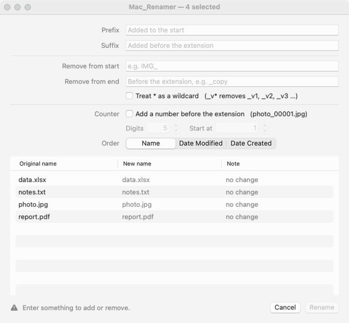
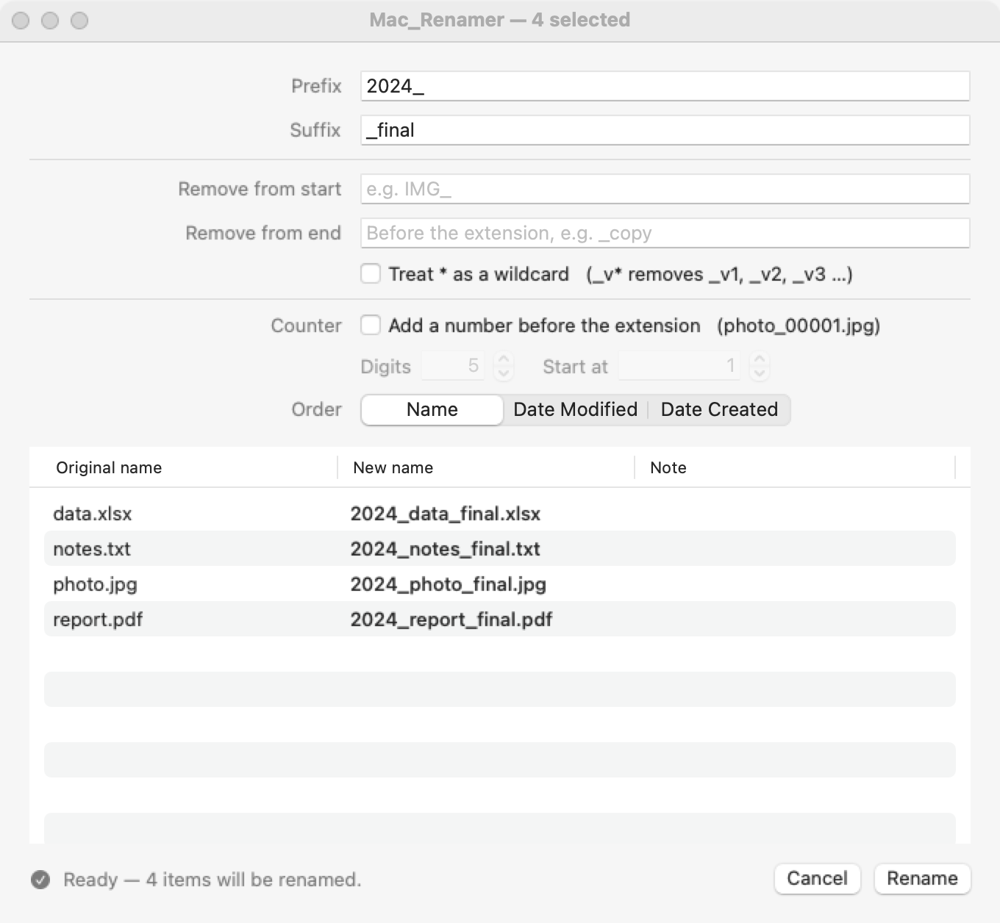

<div align="center">


# 🏷️ Mac_Renamer

### Batch-add a prefix/suffix to your files — right inside Finder.

**Select files → hit <kbd>⌥</kbd>+<kbd>F2</kbd> → type → done.**
No cloud. No telemetry. No subscription. Just one tiny menu bar app. 🪶

A free, open-source bulk file renamer for macOS 13 Ventura and later, written in Swift.
The Mac sibling of [Windows_Renamer](https://github.com/surrealier/Windows_Renamer).

<p>
  <a href="https://github.com/surrealier/Mac_Renamer/releases/latest/download/Mac_Renamer.zip">
    
  </a>
</p>

<p>
  
  
  
  
  <a href="https://github.com/surrealier/Mac_Renamer/actions/workflows/ci.yml"></a>
  
</p>



</div>

---

## 😩 The problem

Finder can rename a batch (**Rename 4 Items…**), but it only does **one thing per pass**:
add text *before* **or** *after* the name, find-and-replace, or throw the names away for
`Custom Format` + a number. Want `2024_` in front **and** `_final` at the end? That's two
rounds of the same sheet, with a preview of just one file.

## ✨ The fix

**Mac_Renamer** keeps every original filename and adds your **prefix** and/or **suffix** in one
go — with a live preview of every file before anything touches the disk.

```
report.pdf   →   2024_report_final.pdf      (prefix "2024_",  suffix "_final")
data.xlsx    →   2024_data_final.xlsx
photo.jpg    →   2024_photo_final.jpg
```

> The **suffix goes before the extension**, so `.pdf` / `.jpg` stay intact. 👌

---

## 🚀 Quick Start

> **TL;DR — paste one line in Terminal, then press `⌥`+`F2` in Finder.**

### ⚡ Option A — One-line install · *Recommended*

```bash
curl -fsSL https://raw.githubusercontent.com/surrealier/Mac_Renamer/main/install.sh | bash
```

It downloads the latest release into **/Applications** and starts it. Because `curl` doesn't
quarantine files, there's no Gatekeeper prompt.

### 📦 Option B — Download the zip

1. ⬇️ **Download [`Mac_Renamer.zip`](https://github.com/surrealier/Mac_Renamer/releases/latest/download/Mac_Renamer.zip)** and double-click it
2. Drag **Mac_Renamer.app** into **Applications** and open it
3. macOS says it can't verify the developer (the app isn't notarized) → **System Settings › Privacy & Security** → **Open Anyway**
   *(or once in Terminal: `xattr -dr com.apple.quarantine /Applications/Mac_Renamer.app`)*

### Then, every time

1. In Finder, **select files** (or folders, or items on the Desktop)
2. Press **`⌥`+`F2`** — on a MacBook keyboard that's **`Fn`+`⌥`+`F2`**
3. Type a **prefix / suffix** → **Rename** ✅

The first time, macOS asks *“Mac_Renamer wants access to control Finder”* — click **OK**. That's how it reads your selection.

<div align="center">
  
</div>

**Other ways in:** right-click the files › **Services › Rename with Mac_Renamer** (no Finder permission needed), drop files on the app's icon, or use the menu bar icon › **Rename Finder Selection…**.

---

## 🧠 Features

- 🏷️ **Prefix + suffix in one shot** — suffix lands *before* the extension
- ✂️ **Remove text** — strip a leading or trailing string before adding (re-prefix in one pass). Tick **“Treat `*` as a wildcard”** and `_v*` auto-removes versioned suffixes like `_v1`, `_v2`, `_v3` …
- 🔢 **Auto-increment counter** — append `00001`, `00002`, … before the extension; set the digits & start number with the steppers, and number by **Name**, **Date Modified** or **Date Created**
- 👀 **Live preview** — see `old → new` for every file as you type, with a note on anything that will be skipped
- ↩️ **Undo** — one click in the result dialog, or menu bar › **Undo Last Rename**
- 🛡️ **Safe by default** — blocks `/` and `:`, never overwrites anything (atomic no-replace rename), isolates per-file failures, won't turn a file into a hidden dotfile
- 📦 **Mac-aware** — `.app`, `.rtfd`, `.pages` and other packages keep their extension; Korean (and other) names stored decomposed by macOS still match what you type
- 🗂️ **Files *and* folders**, in any Finder window, tab or on the Desktop
- ⌨️ **Context-smart hotkey** — `⌥F2` only fires while Finder is in front; everywhere else the key behaves normally. Prefer `⌃⌥R`? Switch it in the menu
- 🪶 **Featherweight** — a menu bar icon, no Dock icon, no background bloat

---

## Finder's `Rename…` vs Mac_Renamer `⌥F2`

| | Finder *Rename N Items…* | **Mac_Renamer `⌥F2`** |
|---|---|---|
| Keep original names | ✅ (Add/Replace Text) | ✅ |
| Prefix **and** suffix in one pass | ❌ one or the other | ✅ |
| Remove leading/trailing text | ⚠️ Replace Text hits it anywhere in the name | ✅ anchored, with `*` wildcard |
| Number files *and* keep their names | ❌ Format replaces the names | ✅ |
| Preview | ⚠️ one example | ✅ every file |
| Keyboard shortcut | ❌ | ✅ |
| Folders too | ✅ | ✅ |
| Undo | ✅ ⌘Z | ✅ |

---

<details>
<summary>⚙️ <b>How it works</b> (for the curious)</summary>

<br>

| Step | Mechanism |
|------|-----------|
| Hotkey scope | Carbon `RegisterEventHotKey` (no Accessibility permission), registered only while `NSWorkspace` reports Finder as the frontmost app and unregistered otherwise |
| Read selection | Apple Events: `tell application "Finder" to get selection as alias list` → POSIX paths (active tab, or the Desktop) |
| Services | `NSServices` entry with `NSSendFileTypes = public.item`, so Finder offers it for any file or folder |
| Name transform | stem/extension split (packages keep theirs) → strip remove-texts (case-insensitive, per grapheme) → `prefix + stem + suffix + counter + "." + ext` |
| Rename | `renamex_np(src, dst, RENAME_EXCL)` — atomic and never overwrites; each item in its own `do/catch` |

Case-only renames (`IMG_a.txt → img_a.txt`) and chains/swaps (where a new name is another
selected item's current name) go through visible temporary names (`~macrenamer-*.tmp`).

The rename logic lives in `Sources/RenamerCore` (plain Foundation); the menu bar app is
`Sources/MacRenamerApp` (AppKit + SwiftUI).

</details>

<details>
<summary>📦 <b>Build it yourself</b> (optional — a prebuilt app is in <a href="https://github.com/surrealier/Mac_Renamer/releases">Releases</a>)</summary>

<br>

```bash
git clone https://github.com/surrealier/Mac_Renamer.git
cd Mac_Renamer
./scripts/build_app.sh          # → dist/Mac_Renamer.app + dist/Mac_Renamer.zip
open dist/Mac_Renamer.app
```

With full Xcode the binary is universal (Apple Silicon + Intel); with only the Command Line
Tools (`xcode-select --install`) it's built for your Mac's architecture.

Releases are built by GitHub Actions: pushing a `v*` tag runs the tests, builds the universal
app and attaches `Mac_Renamer.zip` to the release.

</details>

<details>
<summary>⚠️ <b>Notes & gotchas</b></summary>

<br>

- **“Mac_Renamer wants access to control Finder.”** Click **OK**. Clicked *Don't Allow*? Menu bar icon › **Finder Permission…** (System Settings › Privacy & Security › Automation) and switch on **Finder** under Mac_Renamer. The **Services** route works without it.
- **F-keys on a MacBook** control brightness by default, so use **`Fn`+`⌥`+`F2`**, switch the hotkey to **`⌃⌥R`** in the menu, or turn on *System Settings › Keyboard › Keyboard Shortcuts › Function Keys › Use F1, F2, etc. keys as standard function keys*.
- **Services item missing?** It can take a moment after the first launch. Check *System Settings › Keyboard › Keyboard Shortcuts › Services › Files and Folders › Rename with Mac_Renamer* (you can give it its own shortcut there too), or log out and back in.
- **Dotfiles** (`.gitignore`) are treated as extension-only, so affixes are prepended: `2024__final.gitignore` (which makes it visible). The preview shows exactly what will happen.
- **Counter order** follows the **Order** picker (Name / Date Modified / Date Created) — the same order you see in the preview.
- **Not notarized.** Without a paid Apple Developer ID the app is ad-hoc signed, so a downloaded zip needs *Open Anyway* once (Option A avoids that).
- **Protected folders** (System, other users' files, read-only volumes) show up as per-file *“Operation not permitted”* / *“Permission denied”* in the result summary; the rest of the batch still goes through.

</details>

<details>
<summary>🧪 <b>Tests</b></summary>

<br>

`swift test` runs 79 automated tests: name transform, validation, counter, remove, `*` wildcard,
NFD/NFC matching, packages, the on-disk rename engine, collisions (on disk, inside the batch,
appearing after the preview), case-only renames, chains and swaps, partial-failure isolation and
undo. They run on macOS and Linux in CI.

```bash
swift test
```

</details>

---

## ▶️ Start at Login

The app **adds itself to Login Items on its first run**, so it's there after a restart. Toggle it
any time from the menu bar icon → **Start at Login** (or *System Settings › General › Login Items*).

## 🗑️ Uninstall

```bash
curl -fsSL https://raw.githubusercontent.com/surrealier/Mac_Renamer/main/uninstall.sh | bash
```

It quits the app, removes the login item, saved settings and the Finder permission, and
(after asking) deletes `Mac_Renamer.app`. Prefer manual? Menu bar icon › **Quit**, then drag the
app to the Trash.

---

## 🤝 Contributing

Issues and PRs welcome! Ideas: find & replace, case conversion, regex mode, drag-to-reorder.

## ⭐ Like it?

If Mac_Renamer saved you from a rename rage-quit, drop a star — it genuinely helps. 🙌

## 📄 License

[MIT](LICENSE) — do whatever, just keep the notice.
